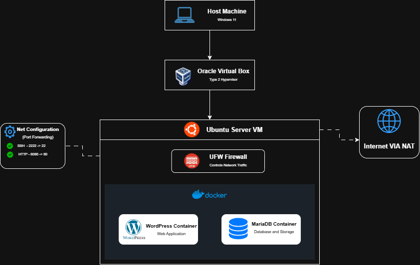

# ☁️ Laboratory 10 – Enterprise Cloud Architect

## 📖 Mission Overview

Congratulations! You have survived the rigorous ranks of CloudNova Technologies. From a Junior Trainee learning basic Linux commands to a Cloud Automation Engineer scripting self-healing infrastructure, you have proven your technical expertise at every level.

Your exceptional track record has caught the attention of the executive board. Cledmar Badongen, the visionary CEO of CloudNova Technologies, has personally selected you for a massive undertaking. You have been promoted to **Enterprise Cloud Architect**.

For your final mission, the training wheels are completely off. There are no step-by-step instructions. You are required to design, deploy, secure, automate, and document a complete, production-ready enterprise infrastructure of your own choosing from scratch. Finally, you will prove your system works by defending it live.

> Remember: **An Architect does not follow a manual; they write it.**

---

## 🎯 Mission Objectives

At the end of this final laboratory activity, you should be able to:

- Conceptualize and diagram a custom enterprise cloud infrastructure.
- Provision and configure a local Virtual Machine running a headless Linux distribution (Ubuntu Server).
- Install and configure Docker and Docker Compose on a fresh operating system.
- Deploy a multi-tier containerized application utilizing persistent data volumes without guided instructions.
- Implement comprehensive system security and port management independently.
- Automate operational tasks (such as disaster recovery or health checks) using custom Bash scripts and task scheduling.
- Synthesize all technical documentation into a professional GitHub Cloud Computing Portfolio.
- Demonstrate and defend your infrastructure live in a simulated corporate boardroom setting.

---

## 🏗️ Architecture



### Architecture Details

The diagram shows how the CloudNova infrastructure is built, from the physical laptop down to the application containers. Each layer runs on top of the one before it.

| Layer | Component | Role |
|---|---|---|
| 1 | **Host Machine** (Windows 11) | The physical laptop that runs everything. It is also used to connect to the server through SSH and to open the website in a browser. |
| 2 | **Oracle VirtualBox** (Type 2 hypervisor) | Creates and runs the virtual machine on top of Windows 11. |
| 3 | **Ubuntu Server VM** | The headless Linux server (no desktop) where the whole stack is installed. |
| 4 | **UFW Firewall** | Controls the network traffic going in and out of the server. It denies incoming connections by default and only allows what is needed. |
| 5 | **Docker** | Runs the application as containers on a private Docker network. |
| 6 | **WordPress Container** | The web application tier. It shows the website to the users. |
| 7 | **MariaDB Container** | The database tier. It stores the website data in a persistent volume. |

### How the Traffic Flows

1. The user opens the website from the host laptop's browser at `http://192.168.56.103:8080`.
2. The request enters the Ubuntu Server VM and passes the firewall rules.
3. Docker sends the request to the **WordPress container**.
4. WordPress talks to the **MariaDB container** through the private Docker network, using the service name `database`.
5. The data is saved in Docker volumes, so it is still there after a container restart or a VM reboot.
6. When the server needs the internet (for updates or image downloads), it goes out through a **NAT** connection.

### Network Configuration

| Interface | IP Address | Type | Purpose |
|---|---|---|---|
| `enp0s3` | `10.0.2.15` | NAT | Internet access for the VM |
| `enp0s8` | `192.168.56.103` | Host-only | Connection between the laptop and the server |

The host laptop uses `192.168.56.1` on the Host-only network.

### Persistent Storage

| Volume | Used By | Purpose |
|---|---|---|
| `mariadb_data` | MariaDB container | Keeps the database files |
| `wordpress_data` | WordPress container | Keeps the WordPress files |

---

## 🧰 Technologies Used

| Technology | Purpose |
|---|---|
| Windows 11 | Host machine |
| Oracle VirtualBox | Type 2 hypervisor |
| Ubuntu Server 26.04.1 LTS | Operating system of the VM |
| Docker and Docker Compose | Running the containers (Infrastructure as Code) |
| WordPress | Web application tier |
| MariaDB 11.4 | Database tier |
| UFW and iptables | Firewall |
| OpenSSH | Secure remote administration |
| Bash and Cron | Automatic database backups |

---

## 📁 Repository Content

| File | Description |
|---|---|
| [README.md](https://github.com/cbadongen/CCM101-cbadongen/blob/main/Laboratory-10-Enterprise-Cloud-Architect/README.md) | Overview of the mission, the architecture, and the project requirements |
| [architecture-diagram.png](https://github.com/cbadongen/CCM101-cbadongen/blob/main/Laboratory-10-Enterprise-Cloud-Architect/architecture-diagram.png) | Network topology and architecture diagram of the infrastructure |
| [docker-compose.yml](https://github.com/cbadongen/CCM101-cbadongen/blob/main/Laboratory-10-Enterprise-Cloud-Architect/docker-compose.yml) | Infrastructure as Code for the WordPress and MariaDB containers with persistent volumes |
| [automation-script.sh](https://github.com/cbadongen/CCM101-cbadongen/blob/main/Laboratory-10-Enterprise-Cloud-Architect/automation-script.sh) | Bash script that backs up, compresses, and verifies the database |
| [operational-manual.md](https://github.com/cbadongen/CCM101-cbadongen/blob/main/Laboratory-10-Enterprise-Cloud-Architect/operational-manual.md) | Handover guide on how to deploy, secure, and maintain the system |
| [final-reflection.md](https://github.com/cbadongen/CCM101-cbadongen/blob/main/Laboratory-10-Enterprise-Cloud-Architect/final-reflection.md) | Personal reflection on the journey from Mission 1 to Mission 10 |

---

## ✅ Requirements Checklist

| Requirement | Status | How It Was Met |
|---|---|---|
| 1. Base infrastructure and diagram | ✅ | Ubuntu Server VM in VirtualBox, accessible from the host browser, with an architecture diagram |
| 2. Deployment | ✅ | `docker-compose.yml` with two linked containers and persistent volumes |
| 3. Security | ✅ | UFW default deny, SSH allowed only from the Host-only network, key-based SSH login, Docker firewall rules |
| 4. Automation | ✅ | `automation-script.sh` scheduled with a daily Cron job |
| 5. Documentation | ✅ | Operational manual, raw code, and final reflection |

---

## 🚀 Quick Start

These are the main steps. The full details are in the [Operational Manual](operational-manual.md).

1. Connect to the server:

   ```powershell
   ssh -i "$env:USERPROFILE\.ssh\cloudnova_ed25519" cloudnova@192.168.56.103
   ```

2. Create the `.env` file in `/opt/cloudnova/` with the database settings (`DB_NAME`, `DB_USER`, `DB_PASSWORD`, and `DB_ROOT_PASSWORD`).

3. Start the application:

   ```bash
   cd /opt/cloudnova
   sudo docker compose up -d
   ```

4. Check that the containers are running:

   ```bash
   sudo docker compose ps
   ```

5. Open the website in the browser of the host laptop:

   ```text
   http://192.168.56.103:8080
   ```

---

## 🔒 Security Summary

- UFW is enabled with a **default deny** policy for incoming traffic.
- SSH is allowed only from the Host-only network (`192.168.56.0/24`).
- SSH uses key-based login only. Passwords and root login are turned off.
- Docker firewall rules allow only the host laptop to reach the WordPress port.
- MariaDB is not exposed to the host network. It can only be reached inside the Docker network.
- Database passwords are kept in a `.env` file that is **never uploaded to GitHub**.

---

## ⚙️ Automatic Backups

The `automation-script.sh` script creates a compressed backup of the database, tests that the file is valid, and deletes backups older than seven days. A Cron job runs it every day at **2:00 AM UTC (10:00 AM Philippine Time)**.

```cron
0 2 * * * /usr/local/sbin/cloudnova-db-backup.sh >> /var/log/cloudnova-backup.log 2>&1
```

---


## ⚠️ Important Notes

- Do not use `docker compose down -v` unless you want to delete the stored data.
- Never upload the real `.env` file or share the database passwords.
- Keep a copy of important backups outside the virtual machine.
