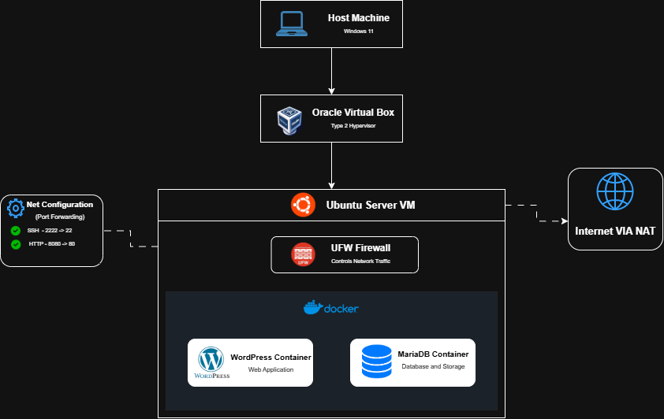

# Operational Manual

## 📖 1. Overview

This manual is the handover guide for the CloudNova website. It explains how to deploy, secure, and maintain the system step by step so that the client's IT team can run it without our help.

CloudNova is a WordPress website. It runs on an Ubuntu Server virtual machine (VM) inside Oracle VirtualBox. Docker is used to run two containers: one for WordPress (the web application) and one for MariaDB (the database). This makes it a **multi-tier** application, because the web tier and the database tier are separated.

The system meets the five project requirements:

| Requirement | How CloudNova Meets It |
|---|---|
| 1. Infrastructure and diagram | Ubuntu Server VM in VirtualBox, with an architecture diagram |
| 2. Deployment | `docker-compose.yml` with WordPress and MariaDB and persistent volumes |
| 3. Security | UFW firewall with default deny, SSH keys only, Docker firewall rules |
| 4. Automation | Bash backup script scheduled with a Cron job |
| 5. Documentation | This manual, the raw code, and the final reflection |

---

## 🗺️ 2. Architecture Overview



The traffic flows like this:

1. The host machine (Windows 11) runs Oracle VirtualBox, which is a Type 2 hypervisor.
2. VirtualBox runs the Ubuntu Server VM.
3. Inside the VM, the UFW firewall controls the network traffic.
4. Docker runs the WordPress container and the MariaDB container inside a private Docker network.
5. The VM reaches the internet through a NAT connection.

---

## 🖥️ 3. System Requirements

**Host machine**

- Windows 11
- Oracle VirtualBox
- An SSH client (Windows PowerShell)
- A web browser
- An internet connection

**Virtual machine**

- Ubuntu Server 26.04.1 LTS
- 35 GB dynamically allocated virtual disk
- Docker Engine and Docker Compose
- UFW firewall
- OpenSSH Server

---

## 📡 4. Server and Network Setup

### 4.1 Virtual Machine Information

| Setting | Value |
|---|---|
| Server name | `cloudnova-server` |
| Linux user | `cloudnova` |
| Operating system | Ubuntu Server 26.04.1 LTS |
| Hypervisor | Oracle VirtualBox |
| Virtual disk | 35 GB |

### 4.2 Network Configuration

The VM has two network adapters.

| Interface | IP Address | Purpose |
|---|---|---|
| `enp0s3` | `10.0.2.15` | Internet access (NAT) |
| `enp0s8` | `192.168.56.103` | Connection between the laptop and the server (Host-only) |

The Windows laptop uses `192.168.56.1` on the Host-only network.

### 4.3 Connecting to the Server

Open Windows PowerShell and run:

```powershell
ssh -i "$env:USERPROFILE\.ssh\cloudnova_ed25519" cloudnova@192.168.56.103
```

Type the SSH key passphrase if it asks for one.

To open the website, type this address in the browser:

```text
http://192.168.56.103:8080
```

---

## 🚀 5. Deployment

### 5.1 Checking Docker

Check that Docker and Docker Compose are installed:

```bash
sudo docker --version
sudo docker compose version
```

### 5.2 Project Location

All project files are stored in `/opt/cloudnova/`. The deployed Compose file is named `compose.yaml`. The copy in GitHub is named `docker-compose.yml`.

### 5.3 The Containers

| Container | Image | Purpose | Storage |
|---|---|---|---|
| `cloudnova-wordpress` | `wordpress:latest` | Web application on `192.168.56.103:8080` | `wordpress_data` |
| `cloudnova-database` | `mariadb:11.4` | Database, reachable only inside the Docker network | `mariadb_data` |

The database settings are kept in a `.env` file so the passwords are not written inside the Compose file. A safe example of this file is shown in Appendix C.

### 5.4 Starting the Application

```bash
cd /opt/cloudnova
sudo docker compose up -d
```

Check that the containers are running:

```bash
sudo docker ps
sudo docker compose ps
```

WordPress waits until MariaDB passes its health check before it starts. This prevents errors caused by WordPress starting before the database is ready.

### 5.5 Stopping and Restarting

```bash
cd /opt/cloudnova
sudo docker compose stop       # stop the containers
sudo docker compose start      # start them again
sudo docker compose restart    # restart them
sudo docker compose down       # remove containers and network, keep the data
```

> **Warning:** Do not use `docker compose down -v` unless you really want to delete the data. The `-v` option deletes the Docker volumes, including the database.

### 5.6 Checking Logs

```bash
sudo docker logs cloudnova-wordpress
sudo docker logs cloudnova-database
sudo docker compose logs -f
```

The last command shows the logs live. Press `Ctrl + C` to stop watching.

---

## 🗄️ 6. Data Storage

CloudNova uses Docker volumes so the data stays safe even when containers are stopped, removed, or recreated, and also when the VM reboots.

| Volume | Location Inside Container | Purpose |
|---|---|---|
| `wordpress_data` | `/var/www/html` | WordPress files |
| `mariadb_data` | `/var/lib/mysql` | Database files |

Useful commands:

```bash
sudo docker volume ls
sudo docker volume inspect mariadb_data
```

Volumes protect the data from container problems, but they are **not** a backup. If the volume is deleted or damaged, the data is lost. That is why the system also makes separate database backups (see Section 8).

---

## 🛡️ 7. Security

### 7.1 UFW Firewall

The firewall blocks all incoming connections by default and only allows what is needed.

```bash
sudo ufw default deny incoming
sudo ufw default allow outgoing
sudo ufw allow from 192.168.56.0/24 to any port 22 proto tcp
sudo ufw enable
sudo ufw status verbose
```

SSH (port 22) is only allowed from the Host-only network `192.168.56.0/24`. No other outside address can reach it.

Docker publishes ports by editing its own firewall rules, which can skip the normal UFW rules. Because of this, the WordPress port is controlled separately (see Section 7.3).

### 7.2 SSH Hardening

SSH uses a private and public key pair instead of a password. This is safer because passwords can be guessed, but a key is very hard to guess.

Settings in `/etc/ssh/sshd_config.d/99-security.conf`:

```text
PermitRootLogin no
PubkeyAuthentication yes
PasswordAuthentication no
KbdInteractiveAuthentication no
MaxAuthTries 3
X11Forwarding no
AllowUsers cloudnova
```

What these settings do:

- `PermitRootLogin no` – nobody can log in as root over SSH.
- `PubkeyAuthentication yes` – SSH keys are allowed.
- `PasswordAuthentication no` and `KbdInteractiveAuthentication no` – password logins are turned off.
- `MaxAuthTries 3` – only three login attempts are allowed per connection.
- `X11Forwarding no` – graphical forwarding is turned off.
- `AllowUsers cloudnova` – only the `cloudnova` user can log in.

Useful commands:

```bash
sudo sshd -t                    # check that the configuration is valid
sudo sshd -T                    # show the active settings
sudo systemctl reload ssh       # apply the changes
```

> **Tip:** Keep your current SSH session open while testing new settings. If the settings are wrong, you can still fix them without losing access.

### 7.3 Docker Firewall Rules

The Docker firewall rules control who can reach the WordPress website. They:

1. Allow existing connections to continue.
2. Allow only the Windows host (`192.168.56.1`) to reach WordPress through the Host-only interface.
3. Block all other traffic going to the published WordPress port.

Check the rules and the service:

```bash
sudo iptables -S DOCKER-USER
sudo systemctl status cloudnova-docker-firewall
```

Files:

- Script: `/usr/local/sbin/cloudnova-docker-firewall.sh`
- Service: `/etc/systemd/system/cloudnova-docker-firewall.service`

### 7.4 Protecting the Database Passwords

The passwords are stored in `/opt/cloudnova/.env`. Check its permissions with:

```bash
sudo ls -l /opt/cloudnova/.env
```

Security reminders:

- Never upload `.env` to GitHub.
- Never share the database passwords.
- Never open MariaDB port 3306 to the host network.
- WordPress connects to MariaDB through the internal Docker network using the service name `database`.

---

## 🕑 8. Automatic Database Backup

### 8.1 The Backup Script

The script is saved on the server at `/usr/local/sbin/cloudnova-db-backup.sh`. The copy in GitHub is `automation-script.sh`. The full code is in Appendix B.

The script does these tasks:

1. Reads the database settings from `.env`.
2. Checks if the MariaDB container is running.
3. Creates a backup of the database.
4. Compresses the backup with Gzip.
5. Tests that the compressed file is not broken.
6. Saves the file with the date and time in its name.
7. Deletes backups that are older than seven days.

The script also uses `set -Eeuo pipefail`, so it stops right away if something goes wrong. If the backup fails halfway, the unfinished temporary file is deleted so a broken backup is never kept.

The script must be executable:

```bash
sudo chmod +x /usr/local/sbin/cloudnova-db-backup.sh
```

### 8.2 Backup Location

Backups are saved in `/opt/cloudnova/backups/`.

```bash
sudo ls -lh /opt/cloudnova/backups/
```

### 8.3 Making a Manual Backup

```bash
sudo /usr/local/sbin/cloudnova-db-backup.sh
```

A successful backup shows:

```text
SUCCESS: Database backup created.
File: /opt/cloudnova/backups/...
Size: ...
```

### 8.4 Checking the Newest Backup

```bash
sudo bash -c 'gzip -t "$(ls -t /opt/cloudnova/backups/*.sql.gz | head -n 1)" && echo "Backup archive is valid."'
```

If it prints `Backup archive is valid.`, the file passed the check.

### 8.5 Cron Schedule

The backup runs every day at 2:00 AM UTC, which is 10:00 AM Philippine Time. It is set in the root user's crontab.

```bash
sudo crontab -e
```

Add this line:

```cron
0 2 * * * /usr/local/sbin/cloudnova-db-backup.sh >> /var/log/cloudnova-backup.log 2>&1
```

The five fields mean: minute `0`, hour `2`, every day of the month, every month, and every day of the week. The `>>` part saves the output to a log file, and `2>&1` also saves the errors.

Check the schedule and the Cron service:

```bash
sudo crontab -l
sudo systemctl status cron
```

### 8.6 Backup Logs

The log file is `/var/log/cloudnova-backup.log`.

```bash
sudo cat /var/log/cloudnova-backup.log
sudo tail -n 50 /var/log/cloudnova-backup.log
```

---

## 🔄 9. Restoring a Backup

> **Warning:** Restoring a backup can replace the current database. Make a copy of the current database first.

Load the database settings:

```bash
cd /opt/cloudnova
set -a
source .env
set +a
```

Set the backup file name (replace it with the real file name):

```bash
BACKUP_FILE="/opt/cloudnova/backups/your_backup_filename.sql.gz"
```

Restore the database:

```bash
sudo bash -c 'gunzip -c "$1" | docker exec -i -e MYSQL_PWD="$2" cloudnova-database mariadb -u root "$3"' _ "$BACKUP_FILE" "$DB_ROOT_PASSWORD" "$DB_NAME"
```

Then check the database logs:

```bash
sudo docker logs --tail 50 cloudnova-database
```

---

## 🛠️ 10. Maintenance and Troubleshooting

### 10.1 Useful Checks

| Task | Command |
|---|---|
| See all containers | `sudo docker ps -a` |
| Restart Docker | `sudo systemctl restart docker` |
| Check disk space | `df -h` |
| Check memory | `free -h` |
| Check network | `ip addr` and `ip route` |
| Check firewall | `sudo ufw status verbose` and `sudo iptables -S DOCKER-USER` |
| Check Docker firewall service | `sudo systemctl status cloudnova-docker-firewall` |
| Check backup log | `sudo tail -n 50 /var/log/cloudnova-backup.log` |

### 10.2 Common Problems

| Problem | Possible Cause | Solution |
|---|---|---|
| WordPress cannot be opened | Container stopped or network problem | Check container status and network settings |
| WordPress cannot connect to MariaDB | Database is not running or not healthy | Check the MariaDB status and logs |
| SSH connection is denied | Wrong key or wrong SSH settings | Check the SSH key and server configuration |
| Backup script fails | Database is down or `.env` is missing values | Check MariaDB and `.env` |
| Server storage is full | Too many files or old backups | Check disk usage and the backup folder |
| Website cannot be opened from Windows | Wrong firewall rules or Host-only settings | Check the Docker firewall rules and network interfaces |

---

## 📌 11. Maintenance Reminders

- Keep the database passwords private.
- Never upload `.env` to GitHub.
- Keep MariaDB reachable only through the internal Docker network.
- Do not turn off a firewall rule unless you understand what it does.
- Check the backup files regularly.
- Keep another copy of important backups outside the virtual machine.
- Do not delete Docker volumes without checking what is inside them.
- Check the available disk space often.
- Read the update notes before updating the application.

---

## ✅ 12. Conclusion

This manual explains how to deploy, secure, and maintain the CloudNova stack. If the steps are followed, the website stays online, access to the server stays protected, the data is kept safe, and database backups are made automatically every day.
